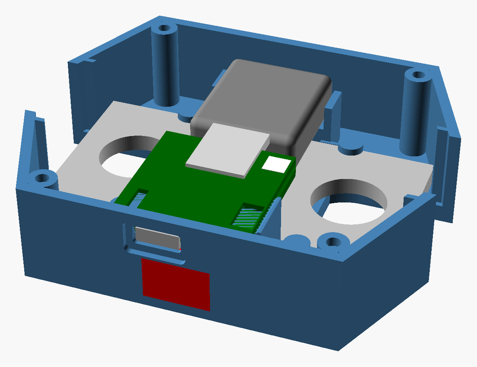

# 3D-Printed Case

The case design is maintained in the [`crimpdeq-case` repository](https://github.com/crimpdeq/crimpdeq-case) and was created with OpenSCAD.

It consists of two parts (main body and lid) and includes mounting points for the load cell, battery, PCB, and switch.

Download the printable files from the [repository releases](https://github.com/crimpdeq/crimpdeq-case/releases) and choose the case that matches your PCB revision: case `v0.4.0` for PCB V1, and the same major version as the PCB from V2 on (for example, case `v3.x` with PCB V3). Each release includes `case_main.stl` and `case_lid.stl`; from `v3.1.0`, it also includes `crimpdeq-case.3mf`, a Bambu Studio project with both parts laid out and the print settings applied. Releases up to `v3.1.0` ship the STLs in assembly orientation, so lay the lid on its outer face before slicing. Print both parts before assembly.

## Revision 3 (Current)

The latest Revision 3 case, [`v3.2.0`](https://github.com/crimpdeq/crimpdeq-case/releases/tag/v3.2.0), measures 103.3 × 77.4 × 25.5 mm and has a hexagonal plan with a carabiner slot at each end. It holds an 800 mAh 102530 battery and is fastened with 4 countersunk self-tapping screws that seat flush in the lid.

- The PCB sits on two columns in front of the battery, with its USB-C connector in the front wall.
- The battery rests on two pads behind the load cell. Lid hold-downs clamp it onto those pads, and a lid stop in front of it keeps it from sliding forward.
- The lid has separate holes for the RGB status LED and the red charging LED.
- Neither part needs support material. See the [repository README](https://github.com/crimpdeq/crimpdeq-case#build-the-bambu-studio-project) for the recommended print settings.

Case `v3.1.0` and earlier V3 releases hold the 2000 mAh battery on top of the load cell, partly under the PCB, and use M2.5×10 machine screws; `v3.1.0` measures 109.8 × 77.4 × 30.6 mm. The [assembly guide](./index.md#1-gather-parts-and-tools) lists the parts for each release.

