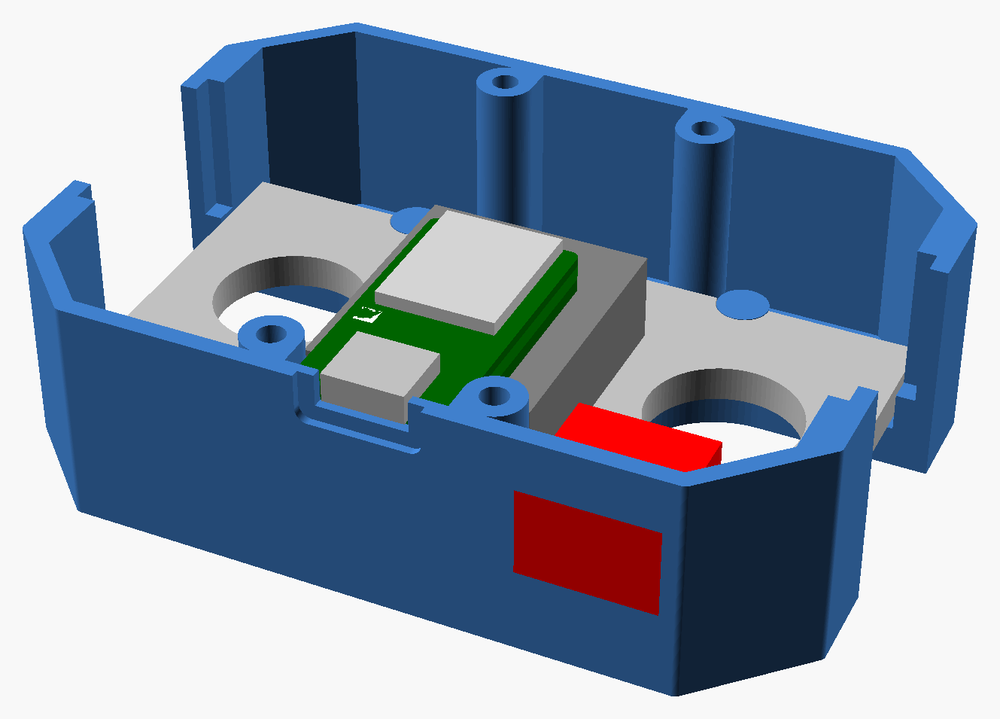
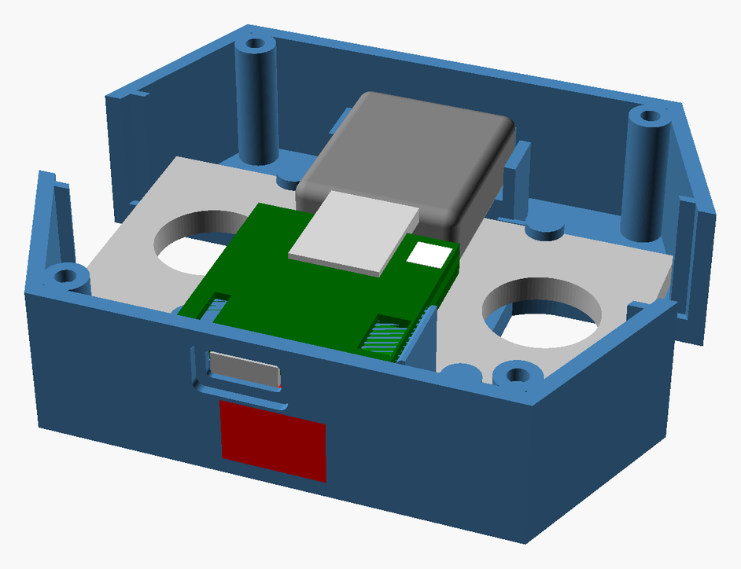

# 3D-Printed Case

The case design is maintained in the [`crimpdeq-case` repository](https://github.com/crimpdeq/crimpdeq-case) and was created with OpenSCAD.

It consists of two parts (main body and lid) and includes mounting points for the load cell, battery, PCB, and switch.

Download the printable files from the [repository releases](https://github.com/crimpdeq/crimpdeq-case/releases) and choose the case that matches your PCB revision: case `v0.4.0` for PCB V1, and the same major version as the PCB from V2 on (for example, case `v4.x` with PCB V4). Each release includes `case_main.stl` and `case_lid.stl`; from `v3.1.0`, it also includes `crimpdeq-case.3mf`, a Bambu Studio project with both parts laid out and the print settings applied. Releases up to `v3.1.0` ship the STLs in assembly orientation, so lay the lid on its outer face before slicing. Print both parts before assembly.

## Revision 4 (Current)

The Revision 4 case, [`v4.0.0`](https://github.com/crimpdeq/crimpdeq-case/releases/tag/v4.0.0), measures 89.2 × 64.6 × 27.6 mm. It has flat front, rear, and end walls with 45° chamfers and a carabiner slot through each end. It holds the same 800 mAh 102530 battery and countersunk self-tapping screws as case `v3.2.0`.

- Everything stacks over the load cell. The load cell goes in with its strain-gauge cover facing the floor, on four floor pads, with floor pins in its edge notches. The battery lies flat on its top face, and the PCB sits over the battery, top side up.
- The PCB rests on two fingers of a floor column, with its USB-C connector in a front-wall opening that is open at the top, so the board drops straight in. A pad in the lid presses the top of the USB-C connector, and a pocket in the front wall leaves room for the plug of the USB-C cable.
- The switch sits in the front wall, right of the USB-C connector.
- A lip under the lid drops inside the main walls and centers the lid before the screws go in.
- The two LEDs shine through 0.4 mm windows that close the lid's LED holes at the outer face, to keep chalk and dust off the board. Print the lid in a light PLA; black PLA blocks the LEDs.
- Neither part needs support material. See the [repository README](https://github.com/crimpdeq/crimpdeq-case/tree/v4.0.0#build-the-bambu-studio-project) for the recommended print settings.

Before printing the full case, you can print the fit coupon in [`case/fit_coupon.scad`](https://github.com/crimpdeq/crimpdeq-case/blob/v4.0.0/case/fit_coupon.scad): the front bands of both parts, with the switch opening, USB-C opening, PCB column, screw posts, LED windows, and lid lip. It is not a release file; export it with OpenSCAD:

```bash
openscad -D 'part="main"' -o fit_coupon_main.stl case/fit_coupon.scad
openscad -D 'part="lid"' -o fit_coupon_lid.stl case/fit_coupon.scad
```

Screw the two parts together and check the fits on your printer.



## Revision 3

The latest Revision 3 case, [`v3.2.0`](https://github.com/crimpdeq/crimpdeq-case/releases/tag/v3.2.0), measures 103.3 × 77.4 × 25.5 mm and has a hexagonal plan with a carabiner slot at each end. It holds an 800 mAh 102530 battery and is fastened with 4 countersunk self-tapping screws that seat flush in the lid.

- The PCB sits on two columns in front of the battery, with its USB-C connector in the front wall.
- The battery rests on two pads behind the load cell. Lid hold-downs clamp it onto those pads, and a lid stop in front of it keeps it from sliding forward.
- The lid has separate holes for the RGB status LED and the red charging LED.
- Neither part needs support material. See the [repository README](https://github.com/crimpdeq/crimpdeq-case#build-the-bambu-studio-project) for the recommended print settings.

Case `v3.1.0` and earlier V3 releases hold the 2000 mAh battery on top of the load cell, partly under the PCB, and use M2.5×10 machine screws; `v3.1.0` measures 109.8 × 77.4 × 30.6 mm. The [assembly guide](./index.md#1-gather-parts-and-tools) lists the parts for each release.


