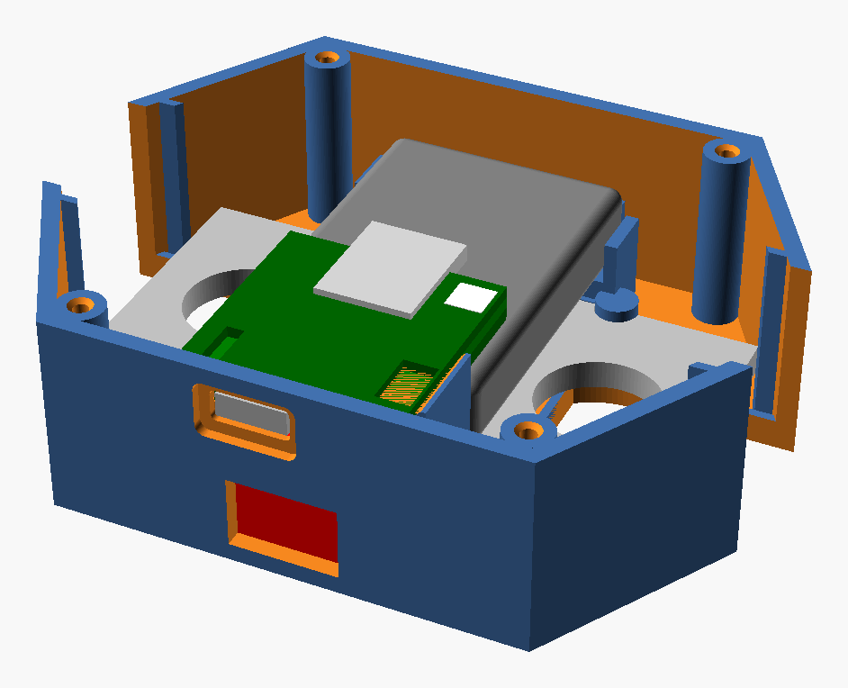

# 3D-Printed Case

The case design is maintained in the [`crimpdeq-case` repository](https://github.com/crimpdeq/crimpdeq-case) and was created with OpenSCAD.

It consists of two parts (main body and lid) and includes mounting points for the load cell, battery, PCB, and switch.

Download the printable files from the [repository releases](https://github.com/crimpdeq/crimpdeq-case/releases) and choose a case with the same major version as your PCB revision; for example, use case `v3.x` with PCB V3. Print both parts before assembly.

## Revision 3 (Current)

The Revision 3 case measures about 97 × 77 × 31 mm and has a hexagonal plan with a carabiner slot at each end. It is fastened with 4 × M2.5×10 screws.

- The PCB sits on two columns in front of the battery, with its USB-C connector in the front wall.
- The lid has separate holes for the RGB status LED and the red charging LED.
- Lid clamps hold the PCB and battery in place so they do not rattle.
- Neither part needs support material. See the [repository README](https://github.com/crimpdeq/crimpdeq-case#build-the-bambu-studio-project) for the recommended print settings.

