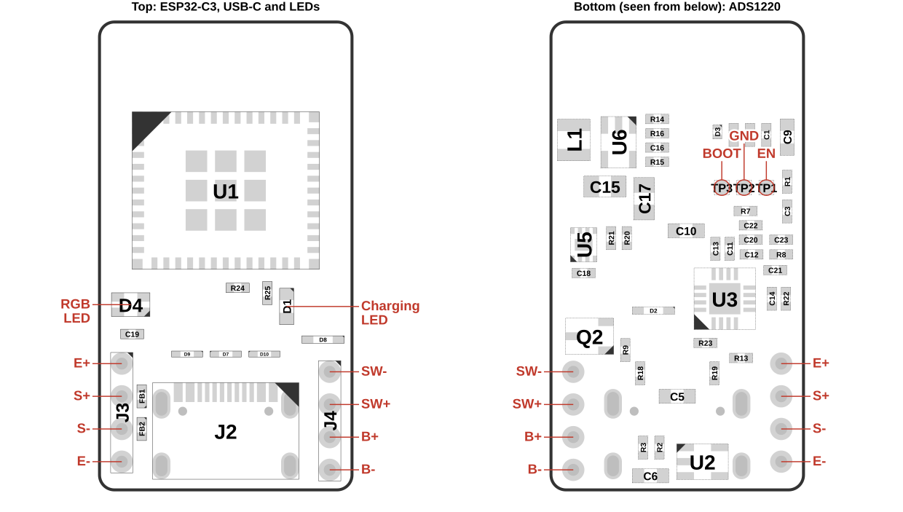
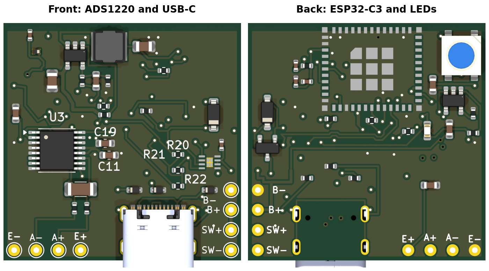
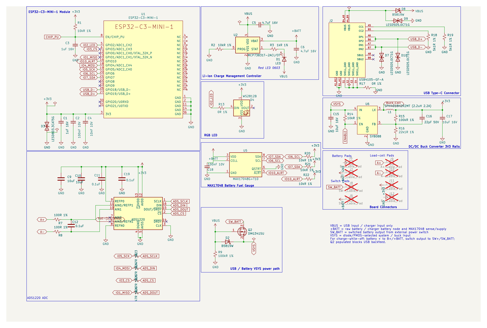
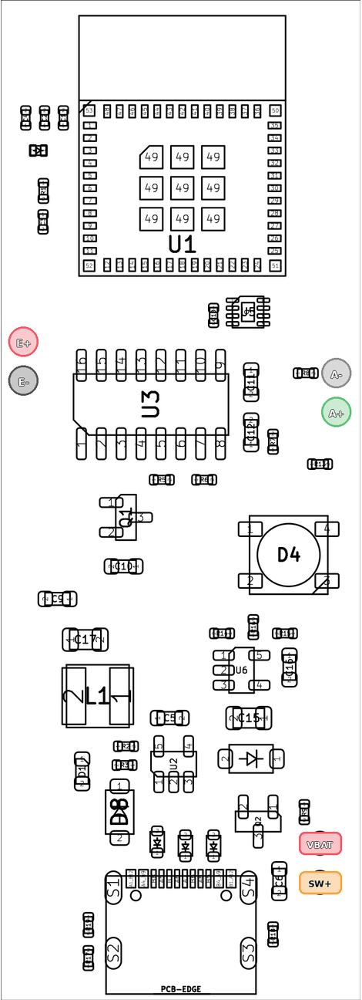

# PCB Design

The PCB design is maintained in the [`crimpdeq-pcb` repository](https://github.com/crimpdeq/crimpdeq-pcb). Revision 4 is designed with [tscircuit](https://tscircuit.com); Revisions 1 to 3 were designed with KiCad and remain available at their release tags.

The design is derived from the [ESP32-C3-DevKit-RUST-1](https://github.com/esp-rs/esp-rust-board). It removes unused sensors from the original design and keeps the components needed by Crimpdeq.

Starting with V2, the PCB, [firmware](../../firmware/index.md), and [case](./case.md) are compatible only within the same major version. For example, PCB V4 requires firmware `v4.x` and case `v4.x`. PCB V1 uses firmware `v0.4.0` and case `v0.4.0`.

## Revision 4 (Current)

Revision 4 ([`v4.0.0`](https://github.com/crimpdeq/crimpdeq-pcb/releases/tag/v4.0.0)) is a 17 × 31.5 mm four-layer board with components on both sides. Its source is [`index.circuit.tsx`](https://github.com/crimpdeq/crimpdeq-pcb/blob/v4.0.0/index.circuit.tsx), and [tscircuit.crimpdeq.com](https://tscircuit.crimpdeq.com) shows the PCB, schematic, and 3D view of the latest design. It keeps the ADS1220 ADC, MAX17048 battery gauge, charging while switched off, and RGB status LED of Revision 3. Compared with Revision 3, it:

- Puts the ESP32-C3 module (with its antenna at the board edge), the USB-C connector, and both LEDs on the top side, and the charger, power path, 3.3 V regulator, battery gauge, and ADC on the bottom side.
- Powers the load cell only while the ADC converts: the ADS1220's internal low-side switch connects `E-` to ground, so the load cell draws no current while the ADC is powered down.
- Filters the load-cell inputs against Bluetooth transmissions, which added spikes of up to 0.98 kg to Revision 3 readings.
- Connects the ADS1220's dedicated data-ready pin and swaps the battery gauge's I2C pins, so firmware `v3.x` does not work on it.
- Uses a 2 × 2 mm XL-2121RGBC-2812B status LED. Its datasheet specifies full function at 4.5 to 5.5 V, so at 3.3 V its blue and green may be dimmer.
- Names the load-cell signal pads `S+` and `S-` instead of `A+` and `A-`, and ties `SW+` to `B+` on the board.
- Adds `EN`, `GND`, and `BOOT` pads on the bottom side to recover the ESP32-C3 in download mode (see [If the flasher cannot connect](../../firmware/web_tools.md#if-the-flasher-cannot-connect)).

The pads are plated through holes. The `J3` load-cell labels are printed on the bottom side only:

The drawings are the assembly drawings from the [`v4.0.0` release](https://github.com/crimpdeq/crimpdeq-pcb/releases/tag/v4.0.0), with the pad labels added. The bottom view is mirrored, as seen from below.

## Revision 3

Revision 3 is a 30 × 30 mm four-layer board. Compared with Revision 2, it:

- Replaces the HX711 with an ADS1220 24-bit ADC for the load cell. The ADC uses ratiometric excitation and supports sampling rates from 20 to 1000 Hz.
- Adds dedicated `B-`, `B+`, `SW+`, and `SW-` pads, so the battery and switch no longer share pads with the load cell or need a jumper.
- Groups the four load-cell pads (`E-`, `A-`, `A+`, `E+`) on one edge, near the ADC and away from the antenna.
- Keeps charging while switched off, the MAX17048 battery gauge, and the RGB status LED.

The ESP32-C3 module, RGB LED, and charging LED are on the back of the board, which faces the lid in the case. The pads are labeled on both sides:

The schematic below was generated from the [`v3.0.0` KiCad source](https://github.com/crimpdeq/crimpdeq-pcb/tree/v3.0.0/pcb/crimpdeq). Open the [PDF version](../../assets/pcb_v3_schematic.pdf) to zoom in.

## Revision 2

Revision 2 adds clearly labeled external wiring pads, a power path that supports charging while switched off, a battery gauge, and an RGB LED. Its battery and switch wiring differs from Revisions 1, 3, and 4; follow the [assembly guide](./index.md#battery-and-switch).

## Revision 1

Revision 1 is a two-layer board that has been tested and works as expected. Its external connections use numbered pads, as shown below.

## Production Files

The PCB was sponsored by [PCBWay](https://www.pcbway.com/). Working with them was fast and easy, and the resulting boards are high quality.

You can find the production files for the current revision in the [latest GitHub release](https://github.com/crimpdeq/crimpdeq-pcb/releases/latest), and its design in the repository. Older revisions are available from the [release archive](https://github.com/crimpdeq/crimpdeq-pcb/releases).

## How to Manufacture
These steps are for Revision 4 ([`v4.0.0`](https://github.com/crimpdeq/crimpdeq-pcb/releases/tag/v4.0.0)). There are two ways to order this PCB:

1. **Using the PCBWay Project page**, if it shows the revision you want to build: it already includes the uploaded production files.
2. **Placing your own PCBWay order** using the production files from the repository releases.

Both ways only load the production files; you still need to apply the [order settings](#order-settings).

### Using PCBWay Projects
1. Open the PCBWay Project page using the button below.

   

2. Confirm that the revision shown on the project page is the one you want to build. If it is not, [place your own order](#placing-your-own-order-on-pcbway).
3. On the right panel, select **PCB+Assembly** and click **Add to Cart**.
4. Apply the [order settings](#order-settings).
5. Enter the desired quantity and click **Calculate**.

   > ⚠️ **Note**: PCBWay shows two quantity fields. One is the number of PCBs to manufacture, and the other is the number of boards to assemble with components. The minimum PCB quantity is usually 5.

6. Choose your shipping country and shipping method.
7. Click **Save to Cart** to continue with checkout.

### Placing Your Own Order on PCBWay
1. Download these files from the release:
   - `crimpdeq-pcb-v4.0.0-pcbway_gerbers.zip`: Gerber and drill files
   - `crimpdeq-pcb-v4.0.0-pcbway_bom.csv`: bill of materials for assembly, with substitution notes
   - `crimpdeq-pcb-v4.0.0-pcbway_centroid.csv`: component placement file for assembly
   - `crimpdeq-pcb-v4.0.0-assembly-top.svg` and `crimpdeq-pcb-v4.0.0-assembly-bottom.svg`: assembly drawings, which mark pin 1 or the cathode of each part
   - `crimpdeq-pcb-v4.0.0-SHA256SUMS`: checksums of the files above
2. Open the [PCBWay PCB quote page](https://www.pcbway.com/orderonline.aspx) and upload the Gerber zip.
3. Enable **Assembly Service** and upload the BOM as the parts list and the centroid file.
4. Apply the [order settings](#order-settings), and add the [assembly notes](#assembly-notes) to the order.
5. Submit the order and wait for the manufacturer review.

   - The manufacturer may contact you with questions about substitutions, assembly notes, or file interpretation.

### Order Settings
PCB options:

| Option | Value |
| --- | --- |
| Board type | Single pieces |
| Size | 17 × 31.5 mm |
| Layers | 4 Layers |
| Material | FR-4, S1000H TG150 |
| Thickness | 1.6 mm |
| Min track/spacing | 5/5 mil |
| Min hole size | 0.3 mm |
| Solder mask | Green |
| Silkscreen | White |
| Surface finish | HASL lead free |
| Via process | Tenting vias |
| Finished copper | 1 oz Cu |
| Inner copper | 1 oz |

If PCBWay asks for the layer order from top to bottom, enter:

| Layer | Gerber file |
| --- | --- |
| L1 | `F_Cu.gbr` |
| L2 | `In1_Cu.gbr` |
| L3 | `In2_Cu.gbr` |
| L4 | `B_Cu.gbr` |

Assembly options:

| Option | Value |
| --- | --- |
| Flexible options | Turnkey |
| Board type | Single pieces |
| Assembly side(s) | **Both sides** |
| Quantity | Number of boards to assemble |
| Contains sensitive components/parts | No |
| Accept alternatives/substitutes made in China | No |
| Function test | No |
| Firmware loading | No |

> ⚠️ **Note**: Revision 4 has components on both sides: the ESP32-C3 module, USB-C connector, and LEDs on the top, and the rest on the bottom. PCBWay selects **Top side** by default; with it, the bottom-side components are not assembled.

### Assembly Notes

Add these notes to the order:

- Reflow the bottom side first; the top side carries the heavy parts (`U1`, `J2`).
- `J2`'s four shell legs are pin-in-paste in the top reflow: top paste over the leg pads, none on the bottom.
- The `J3` and `J4` wire pads have no paste; the load-cell and battery wires are hand-soldered afterwards.
- Paste is 1:1 on normal pads and 50–60 % on the thermal pads (`U1` exposed pad, and the `U3` and `U5` exposed pads).
- The centroid rotations come from tscircuit: confirm each part's orientation against the assembly drawings.

> ⚠️ **Note**: If the manufacturer contacts you with questions or suggestions and you are unsure how to answer, feel free to email me at sergio.gasquez@gmail.com.
