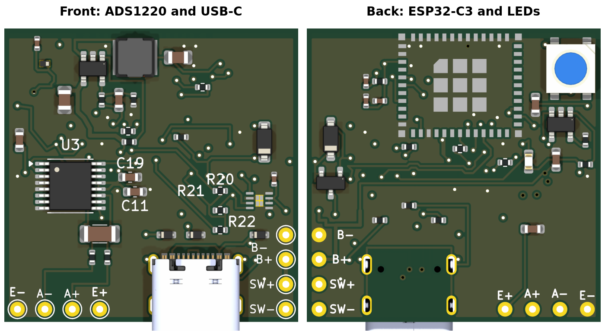
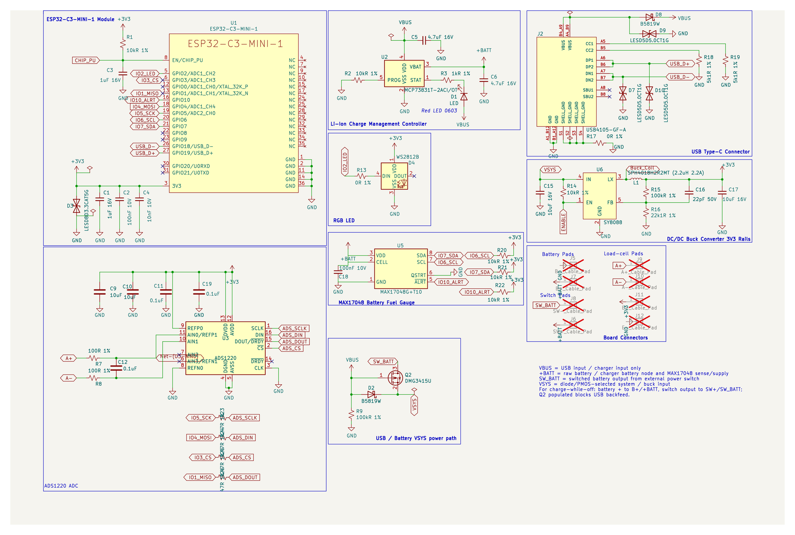
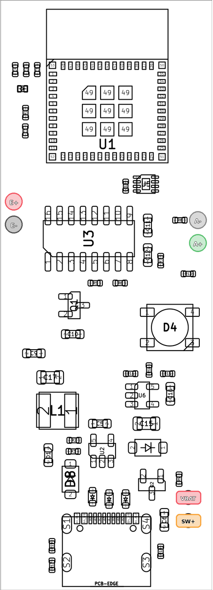

# PCB Design

The PCB design is maintained in the [`crimpdeq-pcb` repository](https://github.com/crimpdeq/crimpdeq-pcb) and was created with KiCad.

The design is derived from the [ESP32-C3-DevKit-RUST-1](https://github.com/esp-rs/esp-rust-board). It removes unused sensors from the original design and keeps the components needed by Crimpdeq.

Starting with V2, the PCB, [firmware](../../firmware/index.md), and [case](./case.md) are compatible only within the same major version. For example, PCB V3 requires firmware `v3.x` and case `v3.x`. PCB V1 uses firmware `v0.4.0` and case `v0.4.0`.

## Revision 3 (Current)

Revision 3 is a 30 × 30 mm four-layer board. Compared with Revision 2, it:

- Replaces the HX711 with an ADS1220 24-bit ADC for the load cell. The ADC uses ratiometric excitation and supports sampling rates from 20 to 1000 Hz.
- Adds dedicated `B-`, `B+`, `SW+`, and `SW-` pads, so the battery and switch no longer share pads with the load cell or need a jumper.
- Groups the four load-cell pads (`E-`, `A-`, `A+`, `E+`) on one edge, near the ADC and away from the antenna.
- Keeps charging while switched off, the MAX17048 battery gauge, and the RGB status LED.

The ESP32-C3 module, RGB LED, and charging LED are on the back of the board, which faces the lid in the case. The pads are labeled on both sides:

The schematic below was generated from the [`v3.0.0` KiCad source](https://github.com/crimpdeq/crimpdeq-pcb/tree/v3.0.0/pcb/crimpdeq). Open the [PDF version](../../assets/pcb_v3_schematic.pdf) to zoom in.

## Revision 2

Revision 2 adds clearly labeled external wiring pads, a power path that supports charging while switched off, a battery gauge, and an RGB LED. Its battery and switch wiring differs from Revisions 1 and 3; follow the [assembly guide](./index.md#battery-and-switch).

## Revision 1

Revision 1 is a two-layer board that has been tested and works as expected. Its external connections use numbered pads, as shown below.

## Production Files

The PCB was sponsored by [PCBWay](https://www.pcbway.com/). Working with them was fast and easy, and the resulting boards are high quality.

You can find the schematic, layout, and production files for the current revision in the [latest GitHub release](https://github.com/crimpdeq/crimpdeq-pcb/releases/latest). Older revisions are available from the [release archive](https://github.com/crimpdeq/crimpdeq-pcb/releases).

## How to Manufacture
There are two ways to order this PCB:

1. **Using the PCBWay Project page** — recommended, since it already includes the latest uploaded production files.
2. **Placing your own PCBWay order** using the production files from the repository releases.

### Using PCBWay Projects
1. Open the PCBWay Project page using the button below.

   

2. Confirm that the revision shown on the project page is the one you want to build.
3. On the right panel, select **PCB+Assembly** and click **Add to Cart**.
4. Enter the desired quantity and click **Calculate**.

   > ⚠️ **Note**: PCBWay shows two quantity fields. One is the number of PCBs to manufacture, and the other is the number of boards to assemble with components. The minimum PCB quantity is usually 5.

5. Choose your shipping country and shipping method.
6. Click **Save to Cart** to continue with checkout.

### Placing Your Own Order on PCBWay
1. Download the production files for your revision from the [GitHub releases](https://github.com/crimpdeq/crimpdeq-pcb/releases).
2. Use the included files when creating your PCBWay order:
   - `gerber.zip`: PCB fabrication files
   - `bom.csv`: bill of materials for assembly
   - `position.csv`: component placement file for assembly
3. Submit the order and wait for the manufacturer review.

   - The manufacturer may contact you with questions about substitutions, assembly notes, or file interpretation.

> ⚠️ **Note**: If the manufacturer contacts you with questions or suggestions and you are unsure how to answer, feel free to email me at sergio.gasquez@gmail.com.
