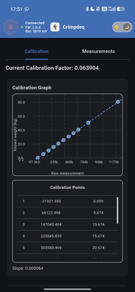

# Calibrate with Crimpdeq App

## Prerequisites
- Crimpdeq app on your platform:
  - Web version (no installation): [app.crimpdeq.com](https://app.crimpdeq.com)
    - Not all browsers support WebBluetooth. Check [browser compatibility](https://developer.mozilla.org/en-US/docs/Web/API/Web_Bluetooth_API#browser_compatibility).
  - Native builds from the latest release: [crimpdeq-app/releases/latest](https://github.com/crimpdeq/crimpdeq-app/releases/latest)
    - Android: `crimpdeq-app-v<x.y.z>.apk`
    - macOS: `crimpdeq-app-v<x.y.z>-macos.zip`
    - Windows: `crimpdeq-app-v<x.y.z>-windows.zip`
    - Linux: `crimpdeq-app-v<x.y.z>-linux.zip`
- A stable mounting point so the device hangs freely and remains still
- At least one known weight (ideally near your typical maximum load)

## Calibration Steps

1. Connect to your Crimpdeq
   1. Launch the Crimpdeq app and grant the Bluetooth permission (Nearby devices on Android 12 and newer, location on Android 11 and older).
   2. Tap **Scan**, then tap **Connect** next to your device.
   3. Once connected, tap the device status in the app bar to see the battery, voltage, and sample rate. The **Firmware** field shows the Progressor version that the device reports to apps (`2.0.4`), not the Crimpdeq firmware release.
2. Add calibration points
   1. Open the **Calibration** tab.
   2. For each point:
     - Hang the corresponding load on the device (or leave it empty for zero).
     - Enter the weight value in the app and tap **Add Calibration Point**.
     - Hold the weight still. The app adds the point once the load stays steady for one second, and reports when it does not settle.
   - **Recommended:** Add at least 2 points—**zero** (nothing hanging) and **full scale** (the maximum weight you expect to measure). The device supports up to 20 calibration points for finer accuracy.
3. Check the result
   1. After adding at least 2 points, the **Calibration Check** plots the points against the curve the device applies and lists the fitted load and residual of each point. Two weights always fit a line, so add a point at a third weight to check a linear calibration; the app then shows the largest and RMS residual. Large residuals point to a swinging load or a wrong weight value. Residuals show how well the curve follows the calibration points, not the accuracy at other loads.
   2. To discard a bad point, tap its remove icon and confirm. The device removes the point and refits the calibration to the remaining points (firmware `v3.x`).
   3. To start over, tap **Reset Calibration To Default**. This restores the default linear calibration and deletes every stored point.

   

Adding more calibration points (up to 20) improves measurement accuracy across the full load range.

## Calibration Models

Firmware with calibration models, released after `v3.0.0`, lets you choose how the device converts readings. The device fits the model to its points; the app shows the model the device reports in use.

| Model            | Use                                                        | Needs                                        |
| ---------------- | ---------------------------------------------------------- | -------------------------------------------- |
| Linear           | Same sensitivity at every load. The default.               | 2 loads; a third checks the fit              |
| Quadratic        | A sensitivity that changes gradually with the load         | 4 loads, one in the middle half of the range |
| Piecewise linear | A sensitivity that changes around one load: two straight lines joined at a break the device finds | 6 loads, 3 on each side of the break |

Loads within 2% of the load range of each other count as one. Start with the linear model and switch only when its residuals show a consistent bend, such as residuals that change sign around one load. A model with more parameters always fits its own points better, so judge it with weights that are not calibration points (see [Validate the Calibration](#validate-the-calibration)).

- Select a model in the **Calibration Model** card while no measurement is running. If the stored points do not support it, the device keeps the model in use and the app shows why.
- When you remove or add a point that leaves the points short of what the model needs, the device stores the points but keeps measuring with the previous calibration, and the app shows that the points are not applied yet.
- The app shows the **calibrated range**, from the lightest to the heaviest calibration load. Outside it, the device extends the curve straight with the slope at the nearest end. The **Measurements** tab flags readings outside the range as extrapolated.
- **Tare** subtracts an attached load, such as a hangboard; the curve stays where it was calibrated. **Set Unloaded Zero** is for a device with nothing attached whose zero drifted: it re-anchors the curve at the current unloaded reading. Use it while no measurement is running. The device rejects it when the reading is more than 1 kg from the calibrated zero.
- Firmware without calibration models offers only the linear model. The Tindeq and Frez apps receive readings converted by the model in use.

## Validate the Calibration

The residuals in the app are calibration-fit residuals, so check the calibration on the device with known weights:

1. Hang the device as it is used and let it settle. Tare with nothing attached, or tap **Set Unloaded Zero**.
2. Load reference weights in ascending steps across the range you use, then unload them in descending steps. At each step, wait until the reading is steady and note it next to the reference weight. Repeat the cycle at least three times.
3. Include held-out weights: loads that are not calibration points, and some between them. Their error is the best estimate of the accuracy of the calibration.
4. Compare the readings with the reference weights: the error at each load, the difference between the ascending and descending readings (hysteresis), the spread between cycles (repeatability), and the reading after unloading (zero return).
5. If the held-out errors are larger than the calibration-fit residuals, the calibration points do not represent the load cell; add points at the loads with the largest errors, or keep a simpler model.

Repeat the check after a firmware update, a large temperature change, or a shock to the load cell.

## Sample Rate

With firmware `v3.x`, the **Measurements** tab lets you choose the sample rate (20 to 1000 SPS) while no measurement is running. The device keeps the rate across reboots, and the Tindeq and Frez apps receive data at that rate.
